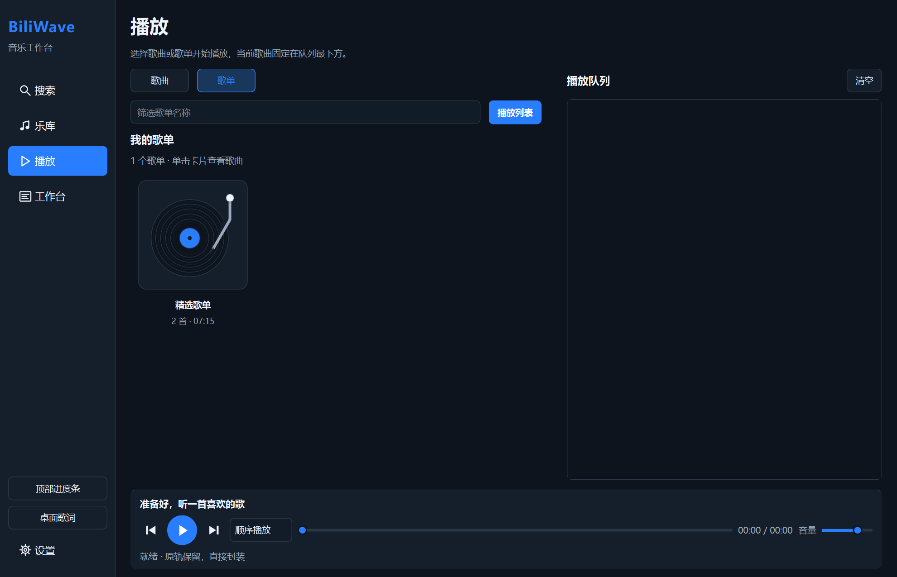
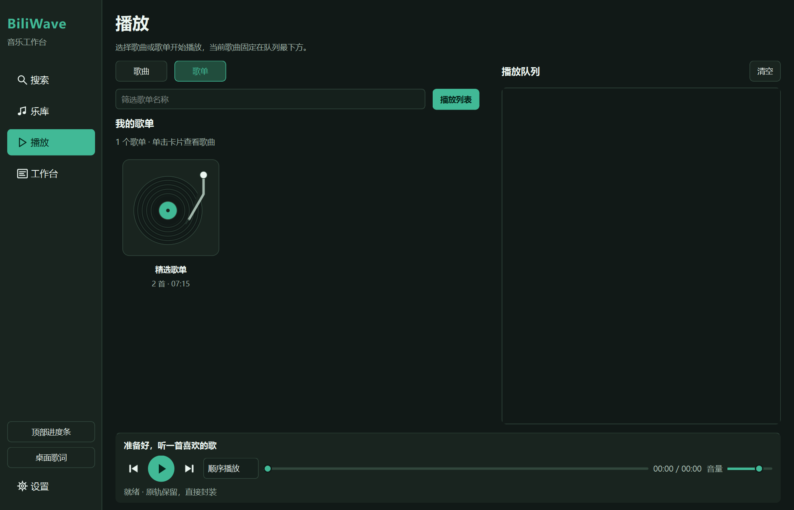
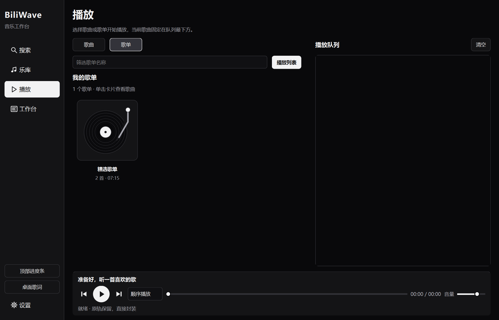
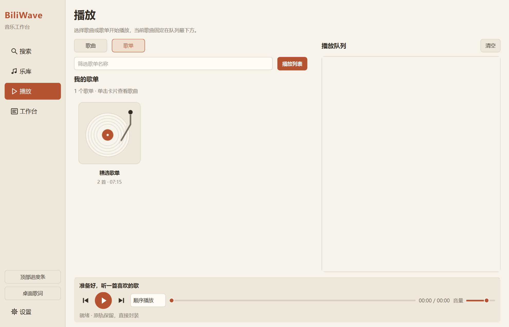
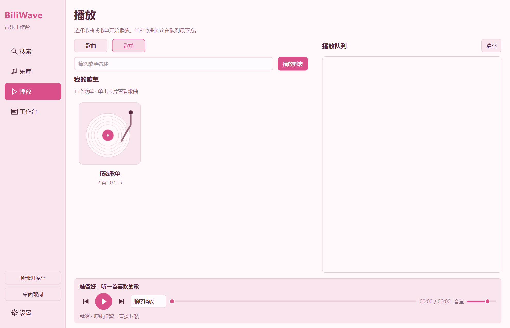

# BiliWave 主题目录

设置 → 通用设置 → 界面主题。五个选项互斥，点击即时应用并保存，滚轮不更改。Full 与 Lite 使用同一目录。

| 名称 | 存储 ID | 视觉方向 | 背景 | 强调色 | 强调色上的前景 |
| --- | --- | --- | --- | --- | --- |
| 大肥鱼 | dark | 原深色蓝色 | #0D141D | #287EFF | #FFFFFF |
| ChatGPT | chatgpt | 深松绿、青绿操作 | #111917 | #41B996 | #05251B |
| Grok | grok | 近黑底、黑白灰 | #09090B | #F2F2F3 | #141416 |
| Claude | claude | 暖米纸、陶土橙 | #F7F3EB | #B45432 | #FFFFFF |
| 浅粉玫瑰 | pink | 原浅粉、梅色文字 | #FFF8FB | #D94F8A | #FFFFFF |

三种新增主题为各产品印象的自主配色设计，不是官方精确色值或官方授权标识。大肥鱼只修改显示名，继续读取旧 `dark`；旧 `pink` 配置保留。未知主题回退大肥鱼。

## 统一规则

- `theme.cpp` 维护目录、调色板与样式，设置页从目录生成选项。绘制歌单、图标、音符、拖动符号和队列时读取同一调色板。
- 强调按钮、选中文字、导航选中项和圆形播放按钮采用 `HighlightedText` 前景，避免 Grok 白按钮配白字、ChatGPT 青绿按钮配浅色图标。
- 输入框、禁用项、悬停、选中、边框和次要文字分别有颜色，整体换色不只替换单个蓝色值。调色板只初始化一次，重绘复用。
- 主题切换保留当前歌曲、时间、队列条目标识、草稿和后台任务。桌面歌词与顶部进度条颜色属于用户单独设置，切换主题不覆盖。
- Qt 弹窗继承主题；Windows 原生文件和颜色选择器使用系统外观。字幕预览保留黑色视频底与绿色框选线，便于区分识别区域。

## 验证

`workbench_tests::themeCatalogModeMigrationAndRendering` 验证五种选择、持久化与恢复、资源注册、文字对比、播放模式旧值迁移、实际页面渲染，以及切歌高亮不重建整个歌曲列表。五种主题普通正文对比度均高于 7；新增主题强调色与前景对比度高于 4.5。

本轮实际截图保存于 `.cache/theme-settings-<id>-full.png`、`.cache/theme-playback-<id>-full.png`，Lite 有对应 `-lite.png`。所有歌曲、歌单均为隔离测试数据。旧截图和历史设计稿仅作为历史记录，当前页面以源码及本轮截图为准。

## 主题预览

以下为测试歌单的实际界面截图。

| 大肥鱼 | ChatGPT | Grok |
| --- | --- | --- |
|  |  |  |

| Claude | 浅粉玫瑰 |
| --- | --- |
|  |  |
