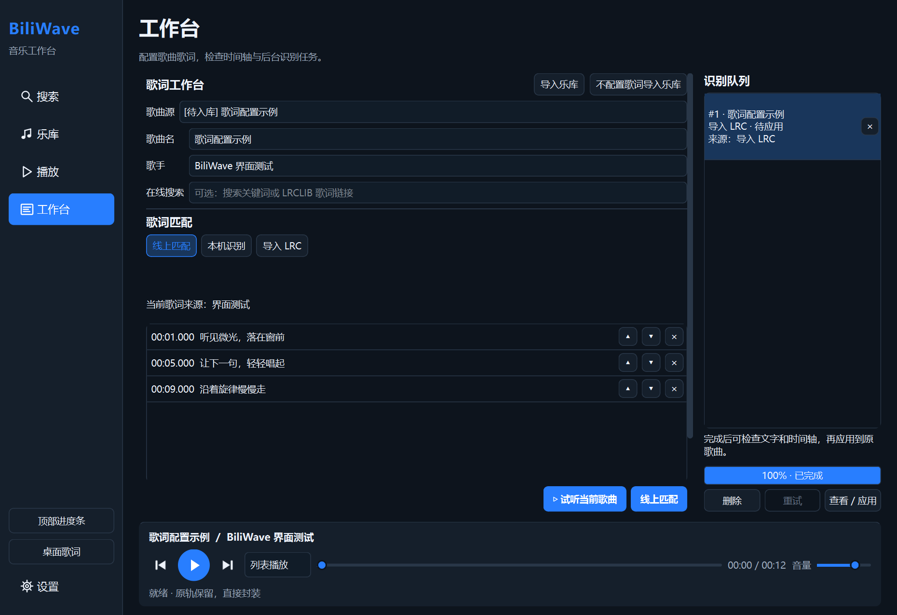
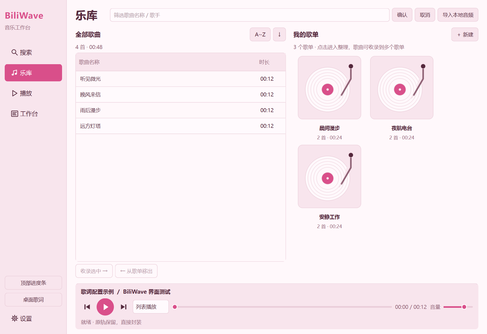

# BiliWave 双主题界面（2026-10-23）

实现参照本机 `BiliWave-UI-Suite-20261023` 设计集的总览与两套 16 张参考图。设计目录位于 `C:/Users/Administrator/Documents/Codex/2026-10-17/file-c-users-administrator-desktop-e7-2/outputs/`。参考稿用于视觉方向；实际按钮、流程、队列顺序、字幕和导出能力以当前工程为准。

## 使用

设置 → 通用设置 → 界面主题：深色蓝色 / 浅粉玫瑰。点击立即应用并保存到 `ui/theme`，重新启动后恢复，默认深色蓝色。选择框互斥，滚轮不切换选项。完整版与无歌词版共享主题。

| 部分 | 实现 |
| --- | --- |
| 颜色 | 深炭底、白字、蓝色操作；暖白 `#FFF8FB`、浅粉 `#F8E5ED`、梅色字 `#54283C`、莓粉操作 `#D94F8A` |
| 侧栏 | 搜索、乐库、播放、工作台，同尺寸矢量图标；设置与显示开关位于下方 |
| 搜索 | 搜索框保留在标题右侧；结果在左，下载任务独立放在右侧，支持拖动分隔宽度 |
| 下载卡片 | 任务栏加宽，标题/状态下方独立一排删除、收录、工作台图标；收录为方形唱片简笔图，工作台与导航图标一致。直接收录后移除完成任务；未完成时禁用收录与工作台，单项删除不取消其他下载 |
| 乐库与播放 | 列表、唱片歌单卡片、菜单、选择状态、队列按钮与旋转音符跟随主题 |
| 工作台 | 保持三种歌词来源及后台识别队列；原有试听和匹配按钮固定在右下，内容可滚动 |
| 设置 | 四类标签仅在设置页面显示；活动标签下划线，内容独立滚动。通用设置提供关闭到托盘、开机自启动及自动消声；自动消声可选择麦克风说话/其他应用开麦，并设置降低幅度。歌词显示、资源与工具保存的内容宽度上限为 820 个逻辑像素，靠左排列，宽窗口右侧留白 |
| 播放器 | 底部改用矢量上一首、圆形播放/暂停、下一首按钮，保留模式、进度、音量和状态 |
| 识别检查 | 默认逐句表格，可双击修改时间/歌词，提前或延后 100 ms、删除整句；另有 LRC 文本页，编辑同步；点击应用后才写入 |
| 弹窗 | 字幕截取、歌词导入、检查结果、歌曲信息编辑及普通确认框继承当前主题；系统原生文件与颜色选择器沿用 Windows 样式 |

字幕范围窗口：图像下方第一行靠右为预览位置与向后 15 s，随后为裁剪边距；采样间隔、画面变化阈值、文字合并相似度排列在同一行，再下方为字幕语言。

自动消声的触发条件包含麦克风说话、其他应用开麦、其他应用发声三个复选框；其他应用发声读取会话音量，排除 BiliWave 自身，静音和无声播放不触发，沿用同一个降低幅度。详见 `AUTO_DUCKING.md`。

字幕语言下方为单项“空格间距敏感度”，默认 50%，调高会降低异常大字间距的判定阈值；再下一行是两行高的当前帧识别结果框和右侧校验按钮，仅使用当前截图的框选区域。详见 `SUBTITLE_FRAME_CHECK.md`。

没有增加设计稿中示意性的搜索分类、专辑/文件夹管理或音频转写。仍通过完成下载任务的工作台按钮/双击将歌曲送入工作台；URL 收藏直接进入乐库。播放队列保留重复项、当前歌曲位于底部，待播从下往上，播放完移除。导出继续保留音轨编码，支持内嵌歌词和同名 UTF-8 LRC。

桌面顶部条仍是独立、无交互的当前歌曲进度显示，与底部播放器分开。主题不会改写已经设置的进度条颜色或桌面歌词字号、透明度、颜色和位置。

## 验证与截图

`tests/redesign_tests.cpp::twoThemesPreservePlaybackAndBackgroundWork` 用本地合成音轨与测试歌词检查两套主题：切换和重启恢复、队列重复项标识与播放状态、待应用歌词保持、表格提前操作不自动保存、主要文字对比度、音符实际绘制颜色，以及 1240×850 / 1040×650 布局。小窗口检查工作台操作按钮仍在可见区域。

截图位于 `docs/screenshots/themes/dark/` 和 `pink/`。示例歌曲与纯色字幕预览属于测试数据，不是在线识别成绩或真实专辑封面。正式验证与程序哈希见 `ui-themes-validation.json`。

